 

<h3>⟦ 01 ⟧ &nbsp; CORE IDENTITY</h3>

<table align="center" border="0" width="100%">
  <tr>
    <td width="58%" valign="top">
      
🎓 <b>Computer Engineering student</b> at <b>Università della Calabria</b>, obsessed with high-performance systems, clean architecture and fluid digital interfaces shaped by Apple's minimalist philosophy.

      
⚡ <b>Code &amp; Scale</b> — turning complex backend logic and algorithms into blazing-fast web and mobile apps.

      
🎧 <b>Fuel</b> — Italian rap and urban production at maximum volume, while the compiler sings.

    </td>
    <td width="42%" valign="top">
      
<b>📌 QUICK SPECS</b>

      <ul>
        <li>🏛️ <b>University:</b> Unical — Ingegneria Informatica</li>
        <li>🧬 <b>Core Stack:</b> Java · Python · C · React · Flutter · Dart</li>
        <li>🧩 <b>Architecture:</b> Component-driven &amp; modular systems</li>
        <li>💻 <b>Hardware:</b> Apple ecosystem + custom Linux/Win rigs</li>
      </ul>
    </td>
  </tr>
</table>

<h3>⟦ 02 ⟧ &nbsp; SOUNDTRACK OF THE CODE</h3>

<h3>⟦ 03 ⟧ &nbsp; TECH ECOSYSTEM</h3>

  

<h3>⟦ 04 ⟧ &nbsp; FEATURED SYSTEMS</h3>

<h3>⟦ 05 ⟧ &nbsp; GITHUB TELEMETRY</h3>

<h3>⟦ 06 ⟧ &nbsp; TROPHY ROOM</h3>

<h3>⟦ 07 ⟧ &nbsp; THE SNAKE IS HUNGRY</h3>

<h3>⟦ 08 ⟧ &nbsp; OPEN CHANNELS</h3>

  

◢ Built by <b>Enzo Pio Cundari</b> ◣

